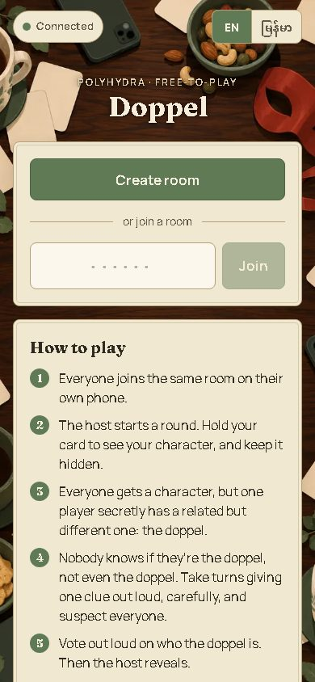
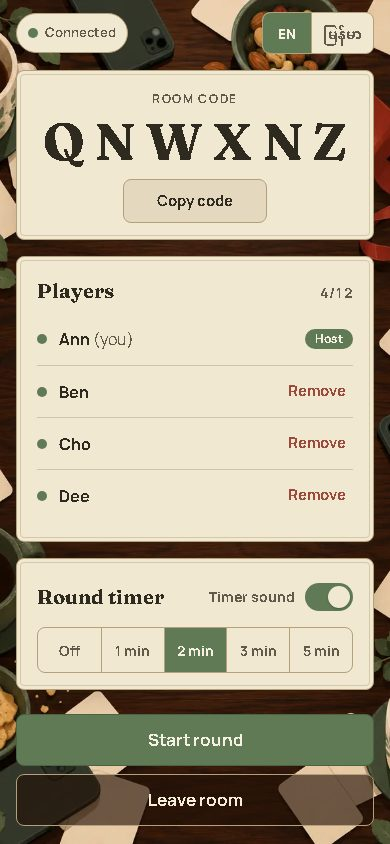
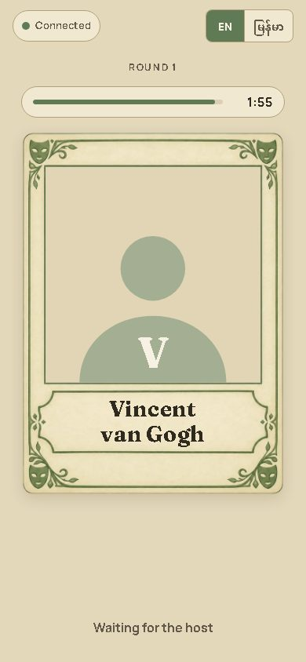
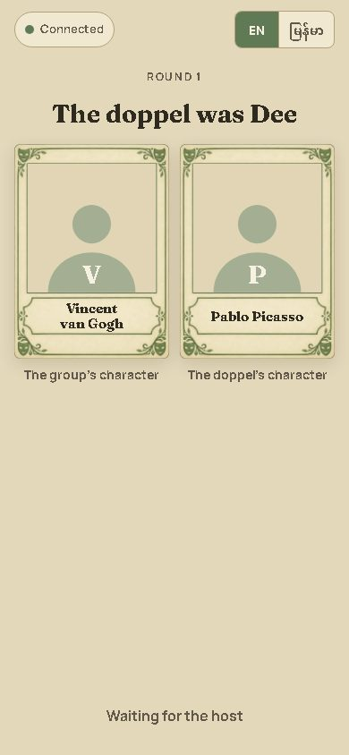

# Doppel

A PolyHydra Free-To-Play party game for one room of phones. Everyone joins a room on
their own phone. When the host starts a round, everyone gets a character, but one random
player, the **doppel**, secretly has a related but different one. **Nobody knows who the doppel
is, not even the doppel**: every card looks the same, and shows only that player's character
while it is held down. So everyone gives clues carefully and suspects everyone. The clues,
discussion and vote all happen out loud, in person; then the host reveals who the doppel was.
The host can also run an optional round timer.

The game was first called "Vote Out the Imposter". The database still uses the `imposter`
schema and its table names (the doppel is `is_imposter` there), so the rename needed no migration.

| Main menu | Game room | Card | Reveal |
| --- | --- | --- | --- |
|  |  |  |  |

Tablet (820 × 1180): [main menu](docs/screens/menu-820.jpg), [game room](docs/screens/room-820.jpg),
[card](docs/screens/card-820.jpg), [reveal](docs/screens/reveal-820.jpg).
Desktop (1440 × 900): [main menu](docs/screens/menu-1440.jpg), [game room](docs/screens/room-1440.jpg),
[card](docs/screens/card-1440.jpg), [reveal](docs/screens/reveal-1440.jpg).
`npm run screens` retakes all twelve against the local Supabase (`SCREENS_SIZES=1024x768,...` and
`SCREENS_DIR` try other sizes without touching these).

**Layouts.** Phones get one column. Tablets held upright get the table art across the whole
screen, behind a wider column, with a larger title and card. Desktops, and tablets held sideways,
get a split layout: the art fills a full-height panel on the left with "Doppel" set large on the
wood, and the content sits on walnut to the right. The game room goes to two columns when there is
room (players on the right), and the round is a wider stage: the card is sized to the screen's
height, its buttons match its width, and the reveal shows both cards at full size.

Stack: Next.js 16 (App Router), React 19, TypeScript, Tailwind CSS 4 and Supabase (the shared
PolyHydra project). Everything runs on free tiers: Vercel Hobby and Supabase Free.

```
src/server/auth.ts        sign-in: the one module the PolyHydra hand-off will replace
src/server/supabase.ts    server-side Supabase clients (the only place the service-role key is used)
src/components/useRoom.ts the phone's view of its room: heartbeat, Realtime ping, reconnect
src/components/*.tsx      screens: main menu, game room, round (the hold-to-reveal card, the timer)
src/lib/sound.ts          the timer's tick and chime (host's phone only)
src/lib/i18n.ts           English and Burmese text (Burmese is a draft, see "Owner steps")
supabase/migrations/      the imposter schema: tables, RLS and every state-changing function
data/                     characters.json and pairs.json (editable); art.json and card-layout.json (npm run art)
scripts/art.mjs           npm run art: icons, menu background and card art from assets/brand/
tests/db/                 RLS privacy and room-rule tests on a real Postgres (PGlite, no Docker)
tests/e2e/                Playwright, four browser contexts, against a local Supabase
```

## Local development

Needs Node 24 and, for the end-to-end tests only, Docker.

```sh
npm install
npx supabase start            # local Supabase in Docker: applies the migration and supabase/seed.sql
npx supabase status -o env    # copy API_URL, ANON_KEY and SERVICE_ROLE_KEY into .env.local (see below)
npm run data:sync             # copies data/pairs.json into the database
npm run dev                   # http://localhost:3000
```

`supabase/seed.sql` creates a **local-only** copy of the shared PolyHydra tables this game reads
(`public.profiles`, `public.login_locks`, `public.login_fail`). It never runs on the shared project.
To sign in locally, make an account in the local stack (Supabase Studio, or the way
`tests/e2e/setup.ts` does) with an approved `public.profiles` row.

Checks:

```sh
npm run lint
npm run typecheck
npm test              # unit tests, the RLS privacy tests and the room rules (PGlite, no Docker)
npm run data:check
npm run e2e           # Playwright; needs `npx supabase start` (it refuses any non-local Supabase)
npm run check         # lint + typecheck + test + data:check
npm run screens       # retakes the README screenshots (local Supabase too)
```

The local stack uses ports 563xx (API on `http://127.0.0.1:56321`), not Supabase's default
543xx, because Windows reserves 54304–54403 on the owner's machine. If `npx supabase start` still
says "ports are not available", `netsh interface ipv4 show excludedportrange protocol=tcp` lists
what Windows has reserved; pick another range in `supabase/config.toml`.

## Supabase setup (the shared PolyHydra project)

The game keeps everything in its own schema, `imposter` (rooms, members, assignments,
recent pairs and pairs), with RLS on every table. It only **reads** the shared
`public.profiles` table and uses the shared sign-in lock (`public.login_locks`, `public.login_fail`).
It never creates, changes or approves accounts.

1. **Run the migrations, in order.** In the Supabase dashboard → SQL Editor, paste and run
   `supabase/migrations/20261102000001_imposter.sql` once, then `20261102000002_timer.sql`, then
   `20261102000003_reveal.sql` (skip the ones you have already run). (Don't use `supabase db push` here:
   the shared project's migration history belongs to The Gilded Delve's repository.)
   It also enables the `pg_cron` extension (available on the Free plan) and schedules an hourly
   job, `imposter-cleanup`, that deletes rooms idle for 6 hours or more. Check it afterwards with
   `select jobname, schedule from cron.job;`. Rooms are also swept whenever someone creates or joins one.
2. **Expose the schema.** Dashboard → Project Settings → Data API → **Exposed schemas**: add
   `imposter` and save. The migration already grants exactly what is needed; you don't need
   Supabase's "grant all" snippet (and RLS holds even if someone runs it; a test proves this).
3. **Realtime.** The game sends an empty "changed" ping on a public channel per room
   (`room:<uuid>`); phones then fetch their own state. Keep Realtime → Settings →
   "Allow public access" on (the default).
4. **Fill the pairs.** With `.env.local` pointing at the shared project: `npm run data:sync`.
   Run it again after every change to `data/pairs.json`.

## Environment variables

| Name | Where | What |
| --- | --- | --- |
| `NEXT_PUBLIC_SUPABASE_URL` | browser + server | Project Settings → API → Project URL |
| `NEXT_PUBLIC_SUPABASE_ANON_KEY` | browser + server | the anon (publishable) key |
| `SUPABASE_SERVICE_ROLE_KEY` | **server only** | the service_role key: sign-in username lookup, the login lock, `npm run data:sync`. Never prefix it with `NEXT_PUBLIC_`; a test checks that only `src/server/supabase.ts` reads it. |

`.env.example` lists them; copy it to `.env.local` (never committed).

## Vercel deployment

1. Push this repository to GitHub and import it in Vercel as its own project (framework: Next.js;
   Node.js 24 in Settings → General).
2. Add the three environment variables above to Production and Preview.
3. Deploy. Every push to `main` redeploys.

## Round timer (optional, host only)

This replaces "no timers" from the original brief.

- **In the game room** the host picks the length: Off, 1, 2, 3 or 5 minutes (2 by default, kept
  for the room). Everyone sees the setting.
- **During a round** the host has Start timer, then +30 s and Stop. There is no pause, and the
  timer never starts on its own. Restart (and End) clears it.
- **Every phone** shows a small countdown bar above the card (never over the card or the place
  you hold) and "Time's up" at 0.
- **Timing comes from the server.** `imposter.timer()` stores the end time, with the room row
  locked, and only the host can call it. `my_state` also returns the server's clock, and each
  phone corrects for its own clock's difference (the most exact of its last 8 heartbeats) and
  counts down to that end time. Phones agree to within about half a second (the e2e test sets
  clocks seconds apart and checks this), and a phone that reconnects or refreshes shows the right
  time straight away.
- **Sound is on the host's phone only.** It plays a soft tick for each of the last 5 seconds,
  then a short chime and a vibration at 0. The host's Start tap unlocks the audio. A "Timer
  sound" switch in the game room (host only) turns it off or on, and each device remembers it.
  Other phones stay silent.
  If the host's page is reloaded mid-countdown, it stays silent until the host taps +30 s (or Start
  on the next timer), because browsers only play sound after a tap.

## Art

The originals go in `assets/brand/` (kept out of git): `icon.png`, `icon-simple.png`,
`menu-bg.png` and `card.png`. Run `npm run art` (sharp) and commit what it writes:

| From | Makes |
| --- | --- |
| `icon-simple.png` | favicon at 16 and 32 px (`public/icons/`, and inside `public/favicon.ico`) |
| `icon.png` | 48 px (in `favicon.ico`), 180 (`apple-touch-icon.png`), 192 and 512 px; the white outside the rounded corners becomes transparent |
| `menu-bg.png` | `public/art/menu-720.webp` and `menu-1152.webp` (srcset), plus its darkest walnut colour (`data/art.json`) |
| `card.png` | `public/art/card.webp` (trimmed, corners transparent) and `data/card-layout.json` |

- **The PWA manifest** (`src/app/manifest.ts`, name "Doppel") lists the 192 and 512 px icons.
- **The menu background** is on the main menu, the game room and "Round in progress": cover,
  centred, never stretched: behind the column on phones, across the screen on tablets, and as the
  left panel on desktops, whose content side uses the art's darkest walnut colour (see "Layouts"
  above). Images are never enlarged: today's `menu-bg.png` is 941 px wide, so
  `menu-1152.webp` is 941 px, and the srcset says so.
- **The card.** The script finds the flat grey window and the cream nameplate on its own and saves
  them as percentages. The card draws the character's image (or the placeholder) in the window
  and the name on the nameplate. It is the same card for everyone, the doppel included: there is
  no label or stamp, so no stamp area is needed. The reveal shows two smaller copies side by side.
- **Without the files** (or before `npm run art`), everything keeps its placeholder: no
  background, the plain cream card and no icons. `next.config.ts` checks which files exist, so the
  build never breaks.

## Characters and images

- `data/characters.json`: `{ "id", "name", "category", "image" }`. `id` is lower-case letters,
  digits and dashes; `category` is free text (actor, musician, artist, superhero, anime…);
  `image` is `"<id>.webp"` (or `null`).
- `data/pairs.json`: related pairs by character id, e.g. `["taylor-swift", "ariana-grande"]`.
  A character may be in several pairs. Each round picks a pair, then randomly decides which side
  the majority gets; the other side goes to the doppel.
- **Images:** drop `public/characters/<id>.webp` (square, 512 × 512) into the folder and redeploy
  (or restart `npm run dev`). Until a file is there, the card shows the matte placeholder:
  a silhouette with the character's initial.
- After any change: `npm run data:check` (unique ids, every pair points to real characters,
  each image exists or uses the placeholder), then `npm run data:sync` if `pairs.json` changed.

## Sign-in and the PolyHydra hand-off

Today `/sign-in` takes a username and password and follows the shared PolyHydra rules
(as in The Gilded Delve): the server finds the account by username (ignoring case); unknown
names and wrong passwords get the same answer after the same one-second wait; 5 wrong passwords
lock that name for 15 minutes; admin accounts are refused; only **approved, not-banned**
accounts get a session. There is no sign-up: accounts come only through admin invites.

The status is read again from `public.profiles` on every request: by the page on load, and by
every database function (`imposter.player()`), so a ban takes effect on the next tap.

**Later: the hub hand-off.** The PolyHydra hub will send a single-use, 60-second code by
form POST, and this game's server exchanges it for a session. To switch:

1. In `src/server/auth.ts`, replace `signIn()` with the code exchange (keep `currentPlayer()`,
   `allowed()` and `signOut()`; they stay the same).
2. Replace `src/app/api/sign-in/route.ts` with a POST handler that reads the form field, calls the
   exchange and redirects to `/`. Point `/sign-in` (or a "Sign in through PolyHydra" link) at the hub.
3. Add the hub's origin to `form-action` in `next.config.ts`'s Content-Security-Policy.

Nothing else in the game depends on how the session was made.

## The reveal (host only)

During a round the host has **Reveal** next to Restart and End. It asks first ("Reveal the
doppel?", Cancel / Reveal). Then every phone shows "The doppel was <display name>" and both
characters side by side, with their pictures and names: the group's character and the doppel's.
`imposter.reveal()` stores this on the room (host only, room row locked), so a refresh or a
reconnect shows it again. The round ends there and the timer stops. The host then uses Restart
(back to the game room) or End, as before. The round's record (both characters and who had the
odd one) is kept on the room when the round starts, so a doppel who left or was removed before
the reveal is still named.

## Rules the code enforces

All of these live in the database functions, which lock the room row first, so two taps
at once can't break a room (`tests/db/rules.test.ts` covers each):

- Room codes: 6 characters with no 0, O, 1 or I; typing ignores case and spaces.
- 3 to 12 players; only the host can remove, start, restart and end.
- Joining during a round queues you ("Round in progress, you'll join next round"); Restart adds you.
- Removed players can't rejoin that room (checked by account).
- One room at a time per account; creating or joining another leaves the first.
- The round timer: only the host sets, starts, extends or stops it; Restart clears it.
- A host away for 3 minutes (in the game room or a round) hands the role to the longest-connected
  player ("<name> is now the host"); a host who leaves hands it over at once. Phones keep their
  screen on in the game room and during rounds (Wake Lock API, where supported), so a phone left
  on the table doesn't count as away. A tab in the background does (the dot turns to "away"
  after about 25 seconds without a heartbeat).
- Leave room asks first ("Leave this room?"); Remove, Reveal, Restart and End ask too.
- Only the host can reveal, once per round; it stops the timer, and Restart clears it.
- Each round: a random pair, a random majority side, a random doppel, avoiding the room's
  last 5 pairs (with 5 pairs or fewer, as many recent ones as possible while one is left).
- Rooms are deleted when ended, or once idle for 6 hours or more (hourly `pg_cron` job, and on
  every create or join).

## Privacy

- **Nobody's phone learns who the doppel is during a round, the host's included.** The server
  records it (`imposter.assignments.is_imposter` and the room's round record), but players can't
  read either: not the rooms, members, pairs or assignments tables, not even their own assignment
  row. `imposter.my_state()` gives each phone its own character id only, which the phone turns
  into a name and picture. It sends no role, flag or pair, and apart from that id every player's
  answer is the same. The player list is names, host and connection only.
- The only way to the role is the host's reveal, and after it everyone sees the same thing.
- Realtime carries only an empty "changed" ping.
- `tests/db/privacy.test.ts` proves this as a player and as anon, even with every table granted.
  The round e2e test records every API response and Realtime frame on all four phones, the host's
  included, until the reveal. It checks that none of them contains the other character, a role,
  a flag or a pair, and that every card has the same layout and animation.
- The service-role key stays on the server.

## Owner steps

1. Run the migrations on the shared project: the first (it also schedules the hourly `pg_cron`
   sweep; check `cron.job`) if you haven't yet, then `20261102000002_timer.sql` and
   `20261102000003_reveal.sql`. Expose
   `imposter`, and run `npm run data:sync` (see "Supabase setup").
2. Create the private GitHub repo and push, then create the Vercel project and add the three
   environment variables.
3. Review the Burmese text in `src/lib/i18n.ts` (every line is a draft, including the timer, How to play and reveal lines).
4. Replace or extend the seed characters and pairs; add images when you have them.
5. Add the game to the PolyHydra hub (`src/lib/games.ts` there) with its `playUrl`, as "Doppel".
6. When the art changes, put the new originals in `assets/brand/`, run `npm run art`, and commit
   the output.
